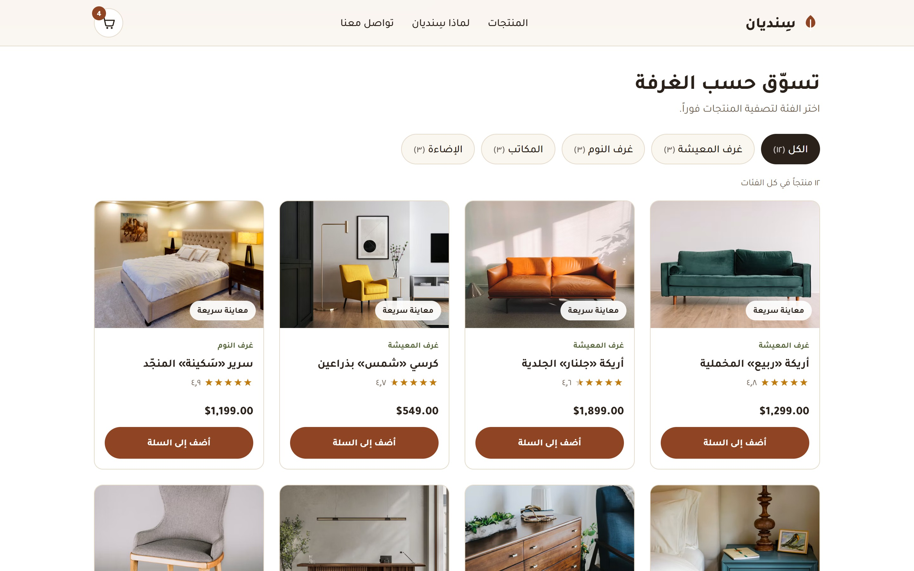
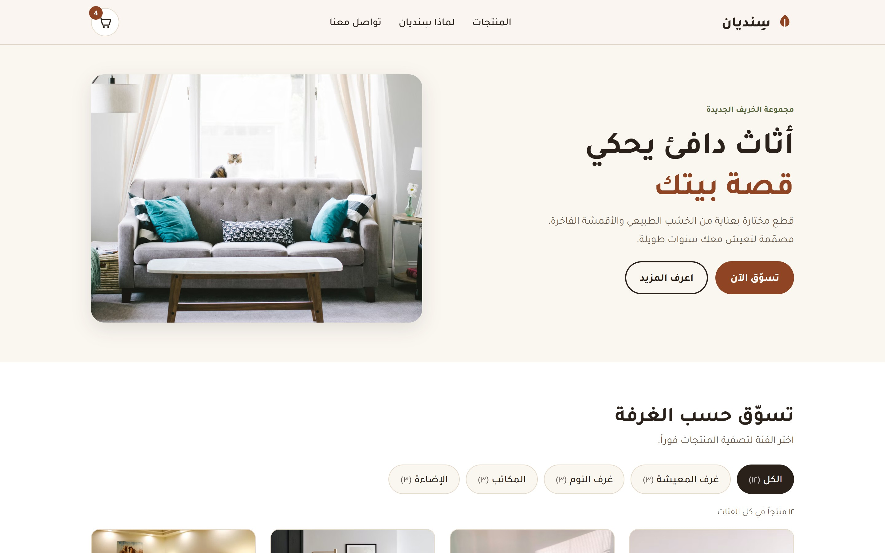
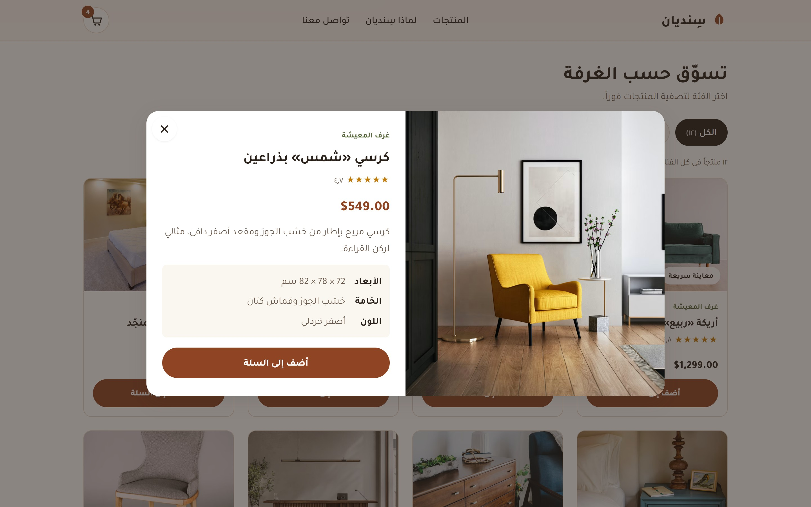
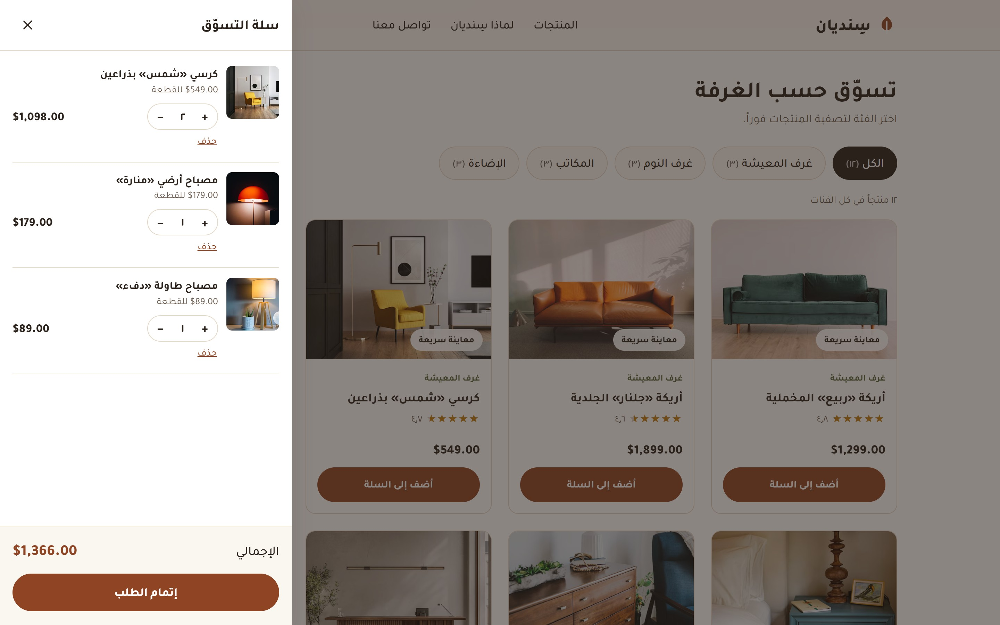
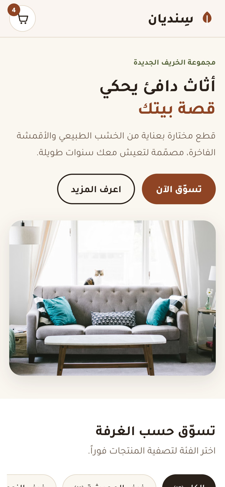
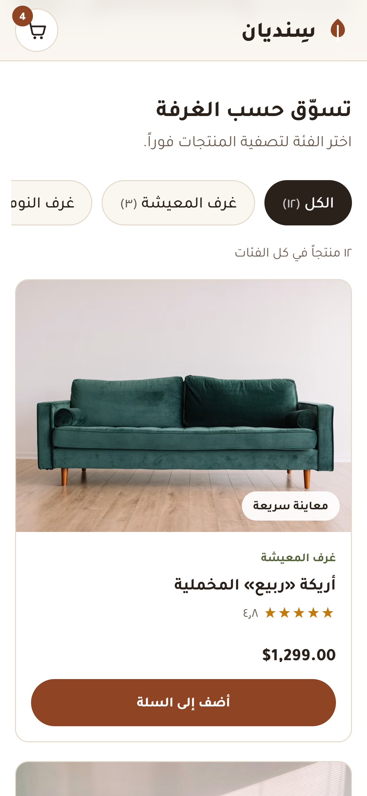
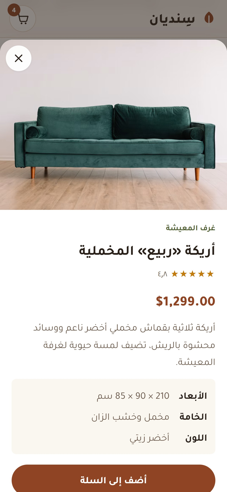
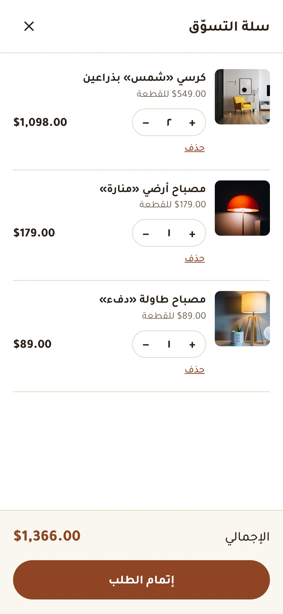
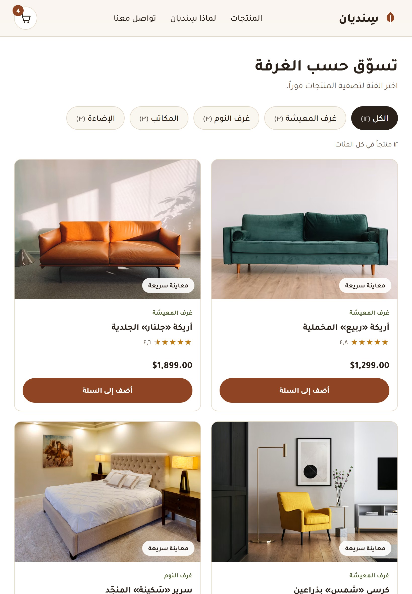

# سِنديان — متجر أثاث إلكتروني

متجر أثاث عصري بالعربية (اتجاه RTL) مبني بـ HTML5 وCSS3 وJavaScript خام بدون أي مكتبات، ومتجاوب مع الجوال والآيباد والحاسوب.



| الصفحة الرئيسية | المعاينة السريعة | السلة الجانبية |
|:---:|:---:|:---:|
|  |  |  |

| الجوال | المنتجات على الجوال | المعاينة على الجوال | السلة على الجوال |
|:---:|:---:|:---:|:---:|
|  |  |  |  |

<p align="center"></p>

> اللقطات بدقة عالية: الحاسوب 2880×1800، الآيباد 1640×2360، الجوال 1170×2532.

## المزايا

- **شبكة منتجات** فيها 12 منتجاً بصور حقيقية، مع الاسم والسعر والتقييم بالنجوم.
- **الأسعار بالدولار الأمريكي** بالصيغة الرسمية (مثل `$1,299.00`)، وهي قريبة من متوسط أسعار التجزئة في السوق الأمريكي لقطع مماثلة من الفئة المتوسطة.
- **التصفية حسب الفئة** (الكل، غرف المعيشة، غرف النوم، المكاتب، الإضاءة) فوراً وبدون إعادة تحميل.
- **سلة جانبية** تنزلق من الجانب: زيادة الكمية وتقليلها، الحذف، حساب الإجمالي تلقائياً، وعدّاد على أيقونة السلة. تُحفظ في `localStorage` فتبقى بعد تحديث الصفحة.
- **معاينة سريعة** لكل منتج: صورة أكبر ووصف وتفاصيل (الأبعاد، الخامة، اللون). تُغلق بزر الإغلاق أو بالضغط خارجها أو بمفتاح Esc.
- **إمكانية الوصول:** كل شيء يعمل بلوحة المفاتيح، تركيز مرئي، حبس التركيز داخل النوافذ المنبثقة، واحترام إعداد تقليل الحركة `prefers-reduced-motion`.

## تشغيل المشروع

افتح `index.html` مباشرة في المتصفح، أو شغّل خادماً محلياً بسيطاً:

```bash
python -m http.server 8000
```

ثم افتح `http://localhost:8000`.

> الصور الحقيقية تُحمَّل من [Unsplash](https://unsplash.com) (مجانية الاستخدام). كل صورة لها عدة مقاسات عبر `srcset` بجودة عالية، فيختار المتصفح المقاس المناسب لعرض الشاشة وكثافتها (مثل شاشات Retina) وبصيغة WebP أو AVIF حين يدعمها. إذا لم يتوفر الإنترنت تظهر مكانها رسوم SVG مضمّنة تلقائياً فتبقى الصفحة سليمة.

## هيكلية الملفات

```
furniture-store/
├── index.html      ← هيكل الصفحة (الترويسة، المنتجات، السلة، نافذة المعاينة)
├── style.css       ← التنسيقات: المتغيرات، الشبكة، Media Queries
├── script.js       ← بيانات المنتجات ومنطق التصفية والسلة والمعاينة
├── screenshots/    ← لقطات الشاشة المعروضة في هذا الملف
├── README.md
└── .gitignore
```

## إضافة منتج جديد

افتح `script.js` وأضف كائناً جديداً إلى مصفوفة `PRODUCTS`:

```js
{
  id: 13,                          // رقم فريد لا يتكرر
  name: 'كرسي «لؤلؤة» الجلدي',
  category: 'living',              // living | bedroom | office | lighting
  price: 699,                      // بالدولار الأمريكي
  rating: 4.6,                     // من 0 إلى 5
  description: 'كرسي بذراعين منجّد بالجلد الأبيض بتصميم كابتوني.',
  details: {
    dimensions: '80 × 85 × 95 سم',
    material: 'جلد صناعي فاخر',
    color: 'أبيض',
  },
  image: '1567538096630-e0c55bd6374c', // رقم الصورة من رابط Unsplash بعد "photo-"
  alt: 'كرسي بذراعين من الجلد الأبيض المنجّد',
},
```

- **الصورة:** من رابط أي صورة على Unsplash مثل `https://images.unsplash.com/photo-1567538096630-e0c55bd6374c` انسخ الجزء الذي بعد `photo-`.
- **فئة جديدة:** أضفها إلى كائن `CATEGORIES` في أعلى `script.js` (مثل `kitchen: 'المطابخ'`)، وسيظهر زرها تلقائياً.
- **تجنّب علامة التنصيص المزدوجة `"` داخل الاسم**، واستعمل «» بدلاً منها.

## تغيير الألوان والخطوط

كل الألوان والخطوط معرّفة كمتغيرات في أعلى `style.css` داخل `:root`:

```css
:root {
  --color-bg: #faf6f0;        /* خلفية الصفحة */
  --color-primary: #8f4424;   /* اللون الرئيسي للأزرار والأسعار */
  --color-accent: #56653a;    /* اللون المساعد */
  --color-text: #2b211b;      /* لون النص */
  --font-body: "Tajawal", "Segoe UI", Tahoma, sans-serif;
}
```

عدّل القيمة مرة واحدة فتتغير في كل الصفحة.

**الخط:** الصفحة تستعمل خط «تجوّل» (Tajawal) من Google Fonts عبر سطر `<link>` في `index.html`. لتغييره اختر خطاً عربياً آخر من [Google Fonts](https://fonts.google.com/?subset=arabic) (مثل Cairo أو IBM Plex Sans Arabic)، واستبدل اسمه في رابط `index.html` وفي المتغيرين `--font-body` و`--font-display`. بدون إنترنت تُستعمل خطوط النظام تلقائياً. احرص على تباين كافٍ بين النص والخلفية (4.5:1 على الأقل).

---

متجر تجريبي لأغراض العرض في معرض الأعمال. الصور من Unsplash.
